 

---

## ✦ About me

I'm an **AI Engineer and Software Engineer** based in Kolkata, India, building **LLM-powered automation systems, AI agents and Retrieval-Augmented Generation (RAG) pipelines** for real-world workflows.

My work sits where AI meets solid engineering: workflow orchestration, cloud-integrated AI systems, scalable backend services, vector databases and microservice architectures, with a strong foundation in infrastructure-aware engineering, CI/CD, REST APIs, Linux environments and production AI deployment.

---

## ✦ Experience

**AI Engineer · Laser Power & Infra** — Kolkata, India
*June 2026 – Present*

- Leading a team building AI-powered applications and automation systems, cutting turnaround time by **10%** by removing manual processes
- Architecting LLM and agentic solutions with **LangChain, LangGraph, RAG and tool calling** across **8+ complex business workflows**
- Automating quotation and tender processing across **1,000+ documents**, reducing manual data extraction and validation effort
- Deploying AI automation across email, notifications and business operations using **n8n and Docker**, saving hours of manual effort every week

**Software Engineer · Struxo Pty Ltd** — Australia (Remote)
*Feb 2025 – May 2026* · promoted from Associate Software Developer within 6 months

- Built AI-driven workflow automation systems with **n8n and LLM integrations** to reduce repetitive operational tasks
- Engineered structured and unstructured data pipelines with **Prisma ORM and PostgreSQL** for AI-ready processing
- Integrated intelligent automation pipelines with third-party systems and APIs to support operational decision workflows
- Architected a production-grade **multi-agent system** with **LangGraph and FastAPI**, designing multi-step LLM chains and independent agents to automate complex research workflows

---

## ✦ Tech stack

**AI & LLM Systems**

**Languages**

**Frameworks & Libraries**

**Databases & Vector Stores**

**Cloud, DevOps & Automation**

---

## ✦ Education

**B.Tech in Computer Science & Engineering** — Techno India University, Kolkata
*2021 – 2025* · CGPA **8.7**

---

## ✦ GitHub stats

---

*"Hustling till satisfaction."*

